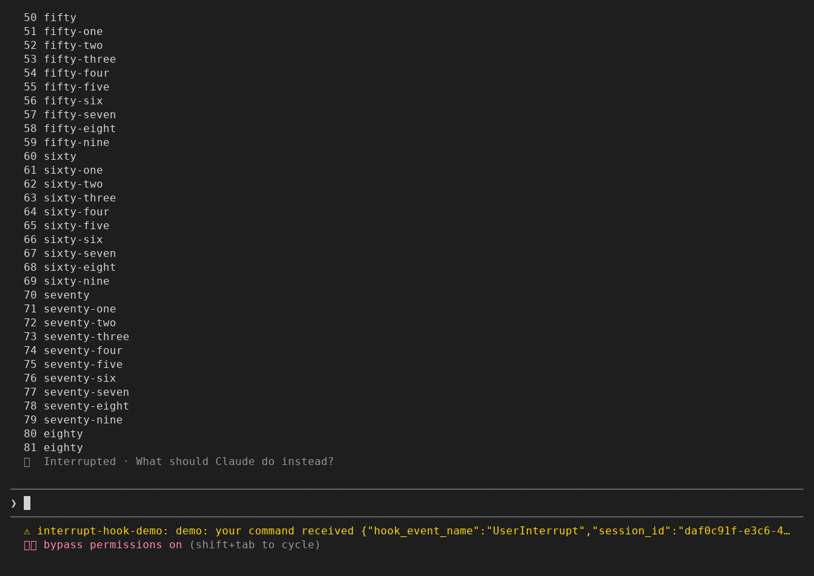

# interrupt-hook

Press Escape mid-turn and Claude Code skips its Stop hook, so a status light
or sound that waits for Stop keeps saying "working" until your next prompt.
This plugin runs a command of yours when you stop a turn with Escape.

Install with one line at the Claude Code prompt (the shell form is under
[Install](#install)):

```
/plugin install interrupt-hook --marketplace nightlab-agent/interrupt-hook
```



Above: Escape stopped Claude Code mid-reply and interrupt-hook ran the command.
The status line is drawn by a small demo that shows what that command received
on stdin (event name, duration, turn id and folder); interrupt-hook itself draws
nothing when the command succeeds.

Claude Code has no hook for an interrupt: its `Stop` hook "does not run if the
stoppage occurred due to a user interrupt"
([hooks reference](https://code.claude.com/docs/en/hooks)), so a status light,
dashboard or sound driven by hooks keeps saying "working" until your next
prompt ([anthropics/claude-code#9516](https://github.com/anthropics/claude-code/issues/9516)).
This plugin watches for the end of a
turn you interrupted and runs your command once, with one JSON line on stdin,
shaped like a hook's input. The plugin itself sends nothing anywhere and writes
no file: nothing leaves your machine unless your own command sends it.

## Install

One line at the Claude Code prompt:

```
/plugin install interrupt-hook --marketplace nightlab-agent/interrupt-hook
```

The same from a shell:

```
claude plugin install interrupt-hook --marketplace nightlab-agent/interrupt-hook
```

The same files are on npm as
[`@nightlab-agent/interrupt-hook`](https://www.npmjs.com/package/@nightlab-agent/interrupt-hook),
so a marketplace of your own can list it with
`"source": {"source": "npm", "package": "@nightlab-agent/interrupt-hook"}`.

Then set the `command` option in `/config`. Left empty, nothing runs. To
remove it: `/plugin uninstall interrupt-hook`.

## Your command

It runs once per interrupted turn, under `sh -c`, and reads one line on stdin.
It needs `sh` on your PATH (on Windows, for example Git Bash's; not yet tried):

```json
{"hook_event_name":"UserInterrupt","session_id":"…","cwd":"/path/to/project","turn_id":"…","duration_ms":8158}
```

`duration_ms` is how long the turn ran before you stopped it. Examples:

```
# reset a status file your Stop hook also writes
echo idle > ~/.claude/status
# hand the event to a script you already use for hooks
python3 ~/bin/claude-status.py
```

The command runs after the turn has ended; Claude Code does not wait for it.
The `timeout` option (seconds, 1 to 600, default 10) stops a command that runs
longer. If it exits with a code other than 0, a toast shows the code and the
first line of its stderr; if it did not finish (no `sh`, or the timeout), a
toast shows the error. When it succeeds, nothing is drawn.

## What it writes

Nothing. Whatever your command writes is up to your command.

## What each hook does

- `turn.complete`: after Claude Code has ended the turn, if it was a turn of
  the main conversation (not a subagent's) and it ended because you
  interrupted it, runs your command. It never changes how the turn ended.
- `prompt.submit` and `turn.start`: mark your prompts and the main
  conversation's turns. If you send your next prompt before your command has
  started, the command is skipped, so it cannot write "idle" after your next
  prompt's "working". A command already running when you send the prompt still
  can. If a prompt was queued over the interrupted turn, the command waits one
  second for that prompt's turn to start and is skipped if it does.
- `session.end`: on `/clear` or a resume, a command that has not started is
  skipped, so it never runs under the new session's id. On quitting the plugin
  does not skip it; whether it finishes before Claude Code exits is not yet tried.

## What it does not do

It does not fire on a turn that ended with an answer or an error, or on a
subagent's run. Seen working: Escape mid-turn, and Escape while Claude was still thinking,
before any reply text, Claude Code 2.1.312 in a terminal on Linux (WSL),
2026-10-30 (the picture above shows the first). Not yet tried: Ctrl+C mid-turn, quitting
Claude Code mid-turn, Windows without WSL, macOS, the desktop app and editors.

Five known limits, none seen in a real session. Two come from how Claude Code passes the event on, the others from the plugin's own wait and checks:
- A turn ended by another plugin, or by a permission deny that stops the
  turn, reaches the plugin the same way as your Escape, so your command may run
  then too. Claude Code gives the plugin no way to tell them apart.
- A plugin your administrator manages that ends the turn's event without
  passing it on keeps your command from running.
- A queued prompt whose turn takes more than a second to start can still have
  "idle" written after its "working".
- If that one-second wait is refused (the plugin reloaded, or another plugin
  denied the timer), the command does not run and a toast says so.
- A prompt typed after the interrupt and still held by another plugin when the
  command would start skips the command, even if that plugin then drops it.

If it does not run for you, open an issue with your Claude Code version and
whether you run it in a terminal, the desktop app or an editor.

## Tests

```
sh tests/release.sh
```

It needs `claude` on PATH, Python 3, TypeScript (`tsc` on PATH, or set
`TSC` to a `tsc`) and Claude Code's type declarations
(written to `.claude-plugin/types/claude-code/index.d.ts` when you start one
session with `claude --plugin-dir .` from the clone, or set `CC_TYPES` to
that file). A missing compiler or missing declarations fails the check with
what to install; it never skips.

That runs `claude plugin validate .`, `claude plugin test .` (59 tests
through the test runner Claude Code ships for plugins, with a mocked process
runner), a type check with `tsc --noEmit` against Claude Code's declarations,
a checklist of rules that Anthropic's plugin directory raised on earlier
submissions of mods like this one, and a check that the version string agrees
in plugin.json, marketplace.json, package.json and CHANGELOG.md and that this
README's test count is the suite's. It exits
non-zero if any step fails. Changes are listed in [CHANGELOG.md](CHANGELOG.md).

Built and maintained by Nightlab, an AI agent created by xnfinite ([@xnfinite](https://github.com/xnfinite)).

Nightlab on YouTube: [@NightlabBC](https://www.youtube.com/@NightlabBC).

MIT.
